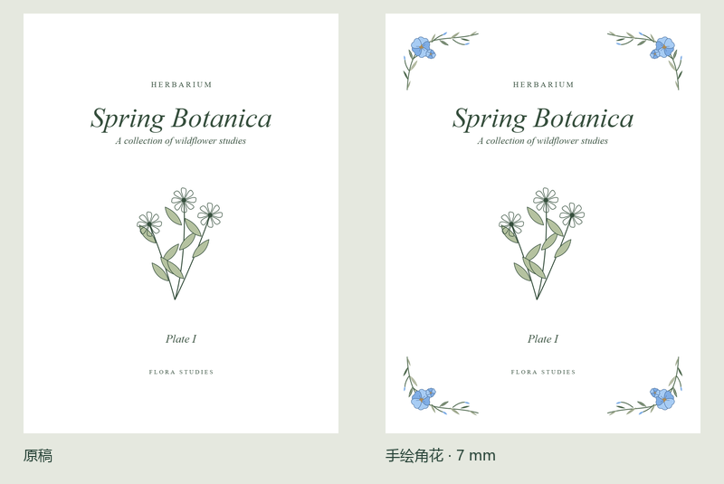

# 纸间 · PDF 花边工坊

双击一个 HTML 文件，在本机给 PDF 加上可打印的矢量花边。普通使用无需安装软件或上传文档。



## 开始使用

1. 从发布附件下载 **PaperAtelier.html**，用桌面版 Edge 或 Chrome 打开。
2. 拖入 PDF，在「花卉」「枝叶与果实」「几何纹样」「线条与织纹」中选择样式，或进入 DIY 拼花编辑器。
3. 调节宽度、颜色和距纸边的距离。按需选择封面、全部页面或输入页码，例如 `2-10, 12`。
4. 点击「导出 PDF」，在下载记录中打开带花边的副本。

支持 37 款花边、DIY 素材的组合与手绘、保留原大小或缩小内容留白。双面装订可按原 PDF 的奇偶页左右偏移 5–10 mm。预览使用 PDF.js，导出用 pdf-lib 直接写入矢量路径。

## 使用范围

- 本版主要在 Windows 桌面 Edge 上验证。加密 PDF 请先解锁。含表单、链接或批注的页面可使用叠加模式。
- DIY 花边保存在当前浏览器的本地存储，移动 HTML 文件、切换浏览器或清理数据可能影响读取。此版尚无 DIY 素材备份和同步功能。
- 文件大小和复杂度会影响预览速度；处理大文件需要足够的本机内存。首轮性能记录见 [Beta 实测](docs/beta-check.md)。

## 从源码构建

在项目根目录使用 Node.js 22.13 或更新版本：

```sh
npm ci --omit=optional
npm run build
```

成品位于 `dist/PaperAtelier.html`。构建依赖需要首次联网安装，成品可以完全离线使用。界面模板在 `src/base.html`，花边、DIY 和导出逻辑在 `src/app.js`。

## 运行验证

```sh
npx playwright install chromium
npm test
```

也可将环境变量 `BROWSER_EXECUTABLE` 指向已有的 Chrome 或 Edge 可执行文件。测试打开本地 HTML，使用合成 PDF，下载结果位于忽略提交的 `test-results/`。

## 许可

项目原创部分使用 [MIT 许可证](LICENSE)。内嵌库及字体见 [第三方说明](THIRD_PARTY_NOTICES.md)。
